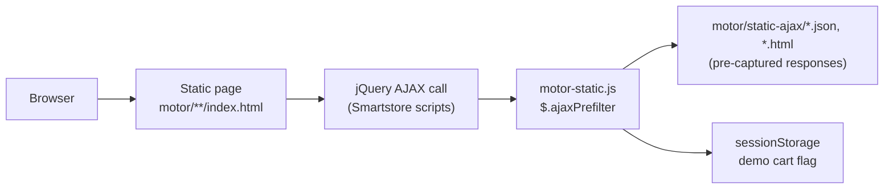

<div align="center">

# MOTOR – Storefront UI Prototype

**A static, clickable dark-theme storefront prototype for a motorcycle parts shop.**
<br/>
<sub>Motosiklet yedek parça mağazası için statik, tıklanabilir, koyu temalı bir vitrin prototipi.</sub>

<br/>


</div>

| | |
|---|---|
| **Type · Tür** | Static UI prototype · Statik arayüz prototipi |
| **Status · Durum** | Prototype, fixed content snapshot (October 2026) · Prototip, sabit içerik (Ekim 2026) |
| **Stack · Teknoloji** | HTML, CSS, JavaScript, jQuery 3.7.1, Bootstrap, Smartstore 6.4 markup |
| **Demo** | [halilmertdeveli.github.io/motor/](https://halilmertdeveli.github.io/motor/) · [motor-vitrin.vercel.app](https://motor-vitrin.vercel.app) |
| **Category · Kategori** | Portfolio / Prototype · Portföy / Prototip |

> [!NOTE]
> All products, prices and customer details are placeholders. There is no backend: no orders, payments, accounts or newsletter sign-ups are processed.
>
> **TR —** Tüm ürünler, fiyatlar ve müşteri bilgileri örnek veridir. Backend yoktur: sipariş, ödeme, üyelik veya bülten kaydı işlenmez.

## Overview · Genel Bakış

This repository holds the generated static output of a storefront theme ("motordark"). The pages were captured from a server-rendered e-commerce storefront and turned into plain HTML. A small script, `motor/motor-static.js`, answers the storefront's AJAX requests from pre-captured files in `motor/static-ajax/`, so menus, the mini cart and add-to-cart feedback work without a server. The real store code (theme source, backend and build scripts) lives in a separate private repository; this repo only contains the static prototype.

**TR —** Bu depo, "motordark" adlı vitrin temasının üretilmiş statik çıktısını içerir. Sayfalar sunucu taraflı bir e-ticaret vitrininden alınıp düz HTML'e dönüştürülmüştür. Küçük bir betik olan `motor/motor-static.js`, vitrinin AJAX isteklerini `motor/static-ajax/` içindeki önceden kaydedilmiş dosyalardan yanıtlar; böylece menüler, mini sepet ve sepete ekleme geri bildirimi sunucu olmadan çalışır. Gerçek mağaza kodu (tema kaynağı, backend ve build betikleri) ayrı, gizli bir depodadır; bu depo yalnızca statik prototipi içerir.

## Features · Özellikler

The UI text is Turkish and prices are placeholder amounts in TRY.
<br/>**TR —** Arayüz metinleri Türkçedir, fiyatlar TRY cinsinden örnek tutarlardır.

| Area · Alan | Capability · Yetenek | Where · Konum |
|---|---|---|
| Home · Ana sayfa | Hero image, category navigation, product lists · Hero görseli, kategori gezintisi, ürün listeleri | `motor/index.html` |
| Categories · Kategoriler | Helmets and gear, brakes, lighting, tyres and wheels, chains, suspension, exhaust, oil and more; brand filter pages · Kask ve ekipman, fren, aydınlatma, jant ve lastik, zincir, süspansiyon, egzoz, yağ ve diğerleri; marka filtre sayfaları | `motor/<category>/index.html` |
| Products · Ürünler | 11 placeholder product pages with image gallery and zoom · Görsel galerisi ve yakınlaştırmalı 11 örnek ürün sayfası | `motor/media/`, PhotoSwipe, Drift |
| Cart · Sepet | Add to cart, off-canvas mini cart, cart page; demo cart state in `sessionStorage` · Sepete ekleme, yan panel mini sepet, sepet sayfası; demo sepet durumu `sessionStorage` içinde | `motor/cart/`, `motor/motor-static.js` |
| Checkout · Ödeme adımları | Billing address, shipping, payment method, confirmation, "order completed" · Fatura adresi, kargo, ödeme yöntemi, onay, "sipariş tamamlandı" | `motor/checkout/` |
| Other pages · Diğer sayfalar | Mobile off-canvas menu, pre-captured instant search, compare, wishlist, login/register, info pages · Mobil yan menü, önceden kaydedilmiş anlık arama, karşılaştırma, istek listesi, giriş/kayıt, bilgi sayfaları | `motor/static-ajax/`, `motor/compareproducts/`, `motor/aboutus/` … |

## How it works · Nasıl çalışır



<sub>AJAX calls are rerouted to static files · AJAX çağrıları statik dosyalara yönlendirilir</sub>

`motor-static.js` maps storefront endpoints (cart summary, off-canvas cart, add to cart, instant search, newsletter, off-canvas menu layers) to files in `motor/static-ajax/`, aborts live price/variant refreshes, and keeps forms inert.

**TR —** `motor-static.js`, vitrin endpoint'lerini (sepet özeti, yan panel sepet, sepete ekleme, anlık arama, bülten, yan menü katmanları) `motor/static-ajax/` içindeki dosyalara eşler, canlı fiyat/varyant yenilemelerini iptal eder ve formları etkisiz tutar.

## Tech stack · Teknoloji yığını

| Layer · Katman | Technology · Teknoloji |
|---|---|
| Pages · Sayfalar | Static HTML, CSS, JavaScript; no build step to serve · Statik HTML, CSS, JavaScript; yayınlamak için build gerekmez |
| Storefront markup · Vitrin işaretlemesi | Smartstore 6.4 markup and scripts, Bootstrap, jQuery 3.7.1, Slick, PhotoSwipe, Drift, AOS, Select2, Moment, Font Awesome Free |
| Theme · Tema | `motor/themes/motordark/` (`theme.css`, `js/motor.js`, Barlow Semi Condensed font) |
| Static AJAX layer · Statik AJAX katmanı | `motor/motor-static.js` (jQuery `ajaxPrefilter`) |
| Hosting · Barındırma | GitHub Pages from the `main` branch root (`.nojekyll`) and Vercel · `main` dalının kökünden GitHub Pages (`.nojekyll`) ve Vercel |

## Structure · Yapı

```text
halilmertdeveli.github.io/
├── index.html                 # Redirects the site root to motor/
├── .nojekyll                  # Serve files as-is on GitHub Pages
└── motor/
    ├── index.html             # Storefront home page
    ├── <category>/, <product>/  # One folder per captured page
    ├── cart/, checkout/       # Cart and checkout step pages
    ├── static-ajax/           # Pre-captured AJAX responses
    ├── themes/motordark/      # Custom dark theme (CSS, JS, fonts, images)
    ├── lib/, js/              # Vendored Smartstore front-end libraries
    ├── media/                 # Product images
    └── motor-static.js        # AJAX-to-static router
```

## Run locally · Yerelde çalıştırma

Serve the repository root with any static file server. Opening files directly (`file://`) breaks the AJAX-driven parts.

**TR —** Depo kökünü herhangi bir statik dosya sunucusuyla yayınlayın. Dosyaları doğrudan (`file://`) açmak AJAX'a bağlı bölümleri bozar.

```bash
git clone https://github.com/HalilMertDeveli/halilmertdeveli.github.io.git
cd halilmertdeveli.github.io
python -m http.server 8080
# then open http://localhost:8080/motor/
```

Merging into `main` redeploys GitHub Pages. · `main` dalına merge edilen her değişiklik GitHub Pages'i yeniden yayınlar.

## Limitations · Sınırlamalar

- No backend: forms do not submit data, and live price or variant updates on product pages are disabled. · Backend yoktur: formlar veri göndermez, ürün sayfalarında canlı fiyat ve varyant güncellemesi kapalıdır.
- Demo content only: search results, menus and cart contents are pre-captured. · Yalnızca demo içerik: arama sonuçları, menüler ve sepet içeriği önceden kaydedilmiştir.
- Fixed snapshot: changing products or pages means regenerating it from the private source. · Sabit içerik: ürün veya sayfa değişikliği için gizli kaynaktan yeniden üretmek gerekir.
- Pages carry `noindex`, so search engines are asked not to index them. · Sayfalarda `noindex` vardır; arama motorlarından dizine eklememeleri istenir.
- No automated tests or CI. · Otomatik test veya CI yoktur.

## Status · Durum

UI prototype from October 2026, published for previewing the design.

**TR —** Ekim 2026'da hazırlanmış, tasarımı önizlemek için yayınlanmış bir arayüz prototipidir.

## Credits and licenses · Emeği geçenler ve lisanslar

- Photos · Fotoğraflar: [Unsplash License](https://unsplash.com/license) – Rohan Krishnan, Jusdevoyage, Brock Wegner, Rob King, Anthony Massaro, Ronnzy Moto, LouisMoto, Fridi Antrack, Justin B, Dmitry Lothbrok.
- Font: Barlow Semi Condensed, SIL Open Font License 1.1.
- Icons · İkonlar: Font Awesome Free (license details in the CSS header · lisans bilgisi CSS başlığında).
- Storefront markup and scripts are derived from [Smartstore](https://github.com/smartstore/Smartstore) (AGPL-3.0). · Vitrin işaretlemesi ve betikleri [Smartstore](https://github.com/smartstore/Smartstore) projesinden türetilmiştir (AGPL-3.0).
